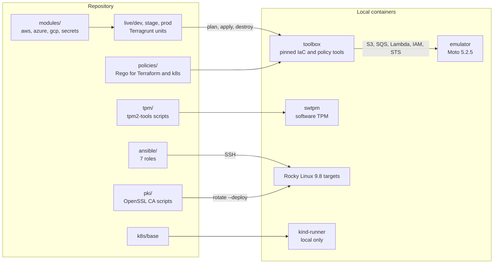
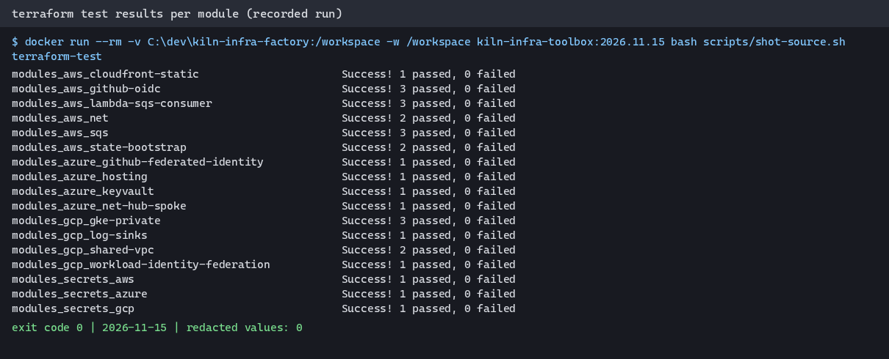
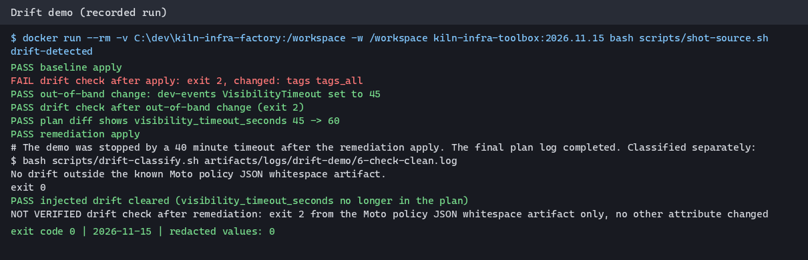
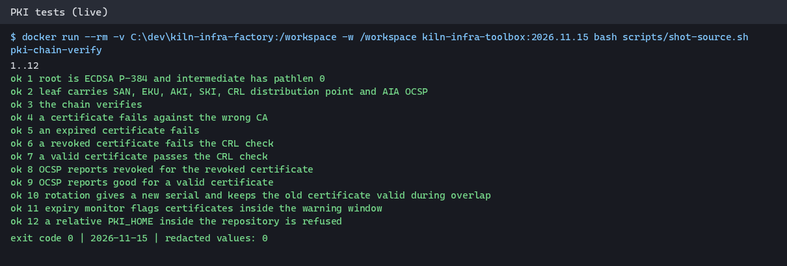

# kiln-infra-factory

Terraform modules for AWS, Azure and GCP with Terragrunt promotion, drift detection, policy as code, Ansible hardening, a two-tier PKI and a software TPM, each with runnable proof on local containers.

**Nothing in this repository was applied to a real cloud account.** AWS modules were applied only to the Moto emulator. Azure and GCP modules were checked with `terraform validate`, mock-provider tests, TFLint, Checkov and OPA. Real deployment is listed under Roadmap.

## Architecture



The diagram source is [docs/diagrams/architecture.mmd](docs/diagrams/architecture.mmd).

## Quick start

```powershell
docker compose build toolbox; docker compose up -d emulator
./scripts/tb.ps1 versions
docker compose run --rm --no-deps toolbox bash scripts/test-modules.sh
```

## Results from real runs

All runs on 2026-11-15 on a Windows 11 workstation with Docker Desktop 29.9.2. Logs are written to `artifacts/logs/`.

| Check | Command | Result |
|-------|---------|--------|
| Terraform modules | `scripts/test-modules.sh` | 17 modules: fmt, validate and examples pass. 28 `terraform test` runs passed, 0 failed |
| TFLint | `scripts/run-tflint.sh` | 34 directories, 0 findings |
| Checkov | `checkov --config-file .checkov.yaml -d modules -d live` | 687 passed, 0 failed, 34 accepted skips each with a written justification |
| OPA unit tests | `opa test policies/terraform policies/k8s` | 34 of 34 passed |
| Conftest on HCL | `conftest test --parser hcl2 --namespace terraform` | 3861 checks passed on modules and live. The bad fixtures produce 12 denials |
| Kubernetes | `kubeconform`, `conftest`, `k8s/kind-apply.sh` | 6 resources valid. 72 Conftest checks passed. kind: 7 PASS, pods run as uid 101 on a read-only root filesystem |
| Terragrunt run-all | `scripts/terragrunt-run-all.sh` | validate passed for all 21 units in dev, stage and prod. dev AWS units: plan, apply and destroy passed on Moto. stage and prod plan, apply and destroy Not verified: one environment took about 4 hours on the Windows bind mount |
| Remote state | `scripts/migrate-state.sh` | Local state migrated to the emulator bucket. A second concurrent apply was refused by the lock |
| Drift | `scripts/drift-demo.sh` | See [drift results](#drift-results) |
| Promotion | `tests/test_promote.ps1` | Passed with stubbed gate commands. dev to stage edits the pin. prod refuses a pin that stage does not run |
| Ansible | `scripts/test-ansible.ps1` | ansible-lint production profile: 0 failures. Second run changed=0 on both targets. testinfra: 16 passed |
| PKI | `bats tests/test_pki.bats` | 12 of 12: chain, wrong CA, expired, CRL revoked, OCSP revoked and good, rotation, expiry monitor, repository path guard |
| PKI deploy | `scripts/test-pki-deploy.sh` | 5 of 5: new serial served by nginx, master PID unchanged on reload |
| Kubernetes certificates | `bats tests/test_pki_k8s.bats` | 8 of 8, including rotation that keeps the system:masters group |
| TPM | `scripts/test-tpm.ps1` | 6 of 6: seal, unseal, unseal fails after extend, quote verifies, wrong nonce fails, NV counter refuses rollback |
| SOPS | `bats tests/test_sops.bats` | 3 of 3: decrypts with the key, fails without it |
| Bash | `bats tests/test_bash_conventions.bats` | strict mode, usage and `--help` on every script. shellcheck 0 findings |
| Style | `scripts/check-style.ps1` | 0 FAIL |

### Drift results

`scripts/drift-demo.sh` changes the `dev-events` visibility timeout to 45 seconds out of band. The drift check exits 2 and the plan shows `visibility_timeout_seconds 45 -> 60`. The remediation apply removes that change from the plan. A clean exit 0 is **Not verified**: Moto returns queue policy JSON with spaces after separators, so the AWS provider reports a whitespace-only change on `redrive_policy` on every plan.

## Screenshots

Rendered from real command output. The full set is in [docs/screenshots.md](docs/screenshots.md).







## Verified versus not verified

| Area | How it was checked | Status |
|------|--------------------|--------|
| AWS modules | Mock tests and apply to Moto | Verified on the emulator. Not deployed |
| Azure modules | validate, mock tests, TFLint, Checkov, OPA | Static and mock only. Not deployed |
| GCP modules | validate, mock tests, TFLint, Checkov, OPA | Static and mock only. Not deployed |
| CloudFront | validate and mock tests. Moto has no CloudFront | Mock only |
| Lambda receives SQS messages | Apply to Moto | Not verified end to end |
| Drift exit 0 after remediation | Emulator | Not verified (Moto JSON whitespace) |
| Terragrunt apply and destroy in stage and prod | Run stopped after dev for time | Not verified |
| Promotion with real gates | Stubbed gate test | Gates individually Verified. A full real promotion run is Not verified |
| Ansible hardening | Two Rocky containers | Verified for files and sshd. firewalld, auditd and kernel parameters Not verified |
| PKI, OCSP and rotation | OpenSSL in containers | Verified |
| TPM | swtpm | Verified on a software TPM. Not a hardware root of trust |
| Kubernetes | kind | Verified. NetworkPolicy enforcement Not verified |
| CI workflows | Written, not run | Not verified until the repository is pushed |
| Explainer media | HyperFrames needs FFmpeg and headless Chrome | Not verified |

## Controls and limits

- Every image is pinned by digest and every tool download is checked against its published SHA-256.
- GitHub Actions are pinned by full commit SHA with `contents: read` and `persist-credentials: false`.
- No long-lived cloud keys exist anywhere. Identity federation is tested in all three clouds.
- Secrets are SOPS files encrypted with age. The private key lives outside the repository.
- A clean scan shows only that the configured checks found nothing. It does not prove the configuration is secure.
- The project makes no compliance claim. The SDL checklist is informed by IEC 62443-4-1.

Threats and risks: [threat model](docs/threat-model.md), [risk assessment](docs/risk-assessment.md).

## Module catalog

| Cloud | Module | Purpose |
|-------|--------|---------|
| AWS | [net](modules/aws/net) | VPC, subnets, NAT, routes, security groups, flow logs |
| AWS | [state-bootstrap](modules/aws/state-bootstrap) | Versioned, encrypted state bucket with locking |
| AWS | [sqs](modules/aws/sqs) | Encrypted queue, DLQ, queue policy |
| AWS | [lambda-sqs-consumer](modules/aws/lambda-sqs-consumer) | Lambda from `lambda/`, least-privilege role, reserved concurrency |
| AWS | [cloudfront-static](modules/aws/cloudfront-static) | S3 origin with OAC, TLS 1.2 minimum, response headers, logging |
| AWS | [github-oidc](modules/aws/github-oidc) | GitHub OIDC role bound to repository and ref |
| Azure | [net-hub-spoke](modules/azure/net-hub-spoke) | Hub and spoke VNets, peering, NSGs, NAT gateway |
| Azure | [hosting](modules/azure/hosting) | App Service with VNet integration, managed identity, HTTPS only |
| Azure | [keyvault](modules/azure/keyvault) | Key Vault with public network access disabled |
| Azure | [github-federated-identity](modules/azure/github-federated-identity) | Federated credential for GitHub Actions |
| GCP | [shared-vpc](modules/gcp/shared-vpc) | Host and service projects, subnet IAM, Cloud NAT, deny-by-default firewall |
| GCP | [gke-private](modules/gcp/gke-private) | Private nodes, workload identity, shielded nodes, network policy |
| GCP | [log-sinks](modules/gcp/log-sinks) | Sinks to Cloud Storage and BigQuery with exclusions |
| GCP | [workload-identity-federation](modules/gcp/workload-identity-federation) | GitHub OIDC pool bound to repository and ref |
| All | [secrets](modules/secrets) | Secrets Manager, Key Vault secret and Secret Manager with single-identity access |

Each module README holds its inputs and outputs generated by terraform-docs.

## Layout

```text
modules/{aws,azure,gcp,secrets}   reusable Terraform modules
live/{dev,stage,prod}             Terragrunt units and env.hcl pins
policies/                         Rego for Terraform and Kubernetes
ansible/                          roles and playbooks for Rocky Linux
pki/  tpm/  k8s/                  CA scripts, TPM scripts, kind workload
docker/                           toolbox, emulator, swtpm, Rocky target, kind-runner
scripts/  tests/                  automation and tests
docs/                             documentation index: docs/README.md
```

## Roadmap

- Planned: deploy the AWS, Azure and GCP modules to real sandbox accounts with OIDC federation.
- Planned: end-to-end Lambda delivery test, KMS customer keys, Lambda code signing.
- Planned: Rocky virtual machine for firewalld, auditd and kernel parameter checks.
- Planned: TPM attestation with endorsement key certificate checks on hardware.

## Licence

[MIT](LICENSE)
