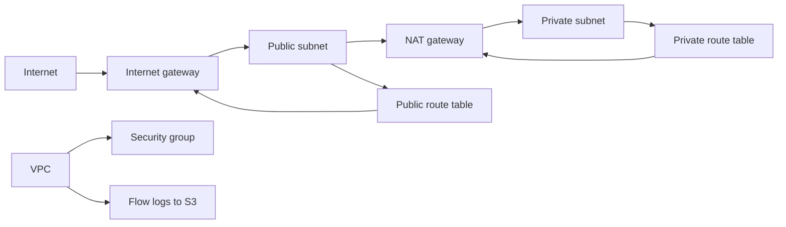
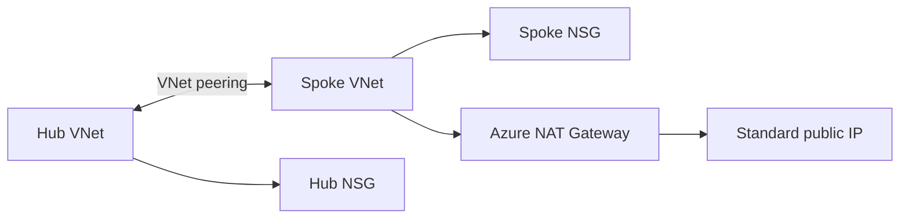
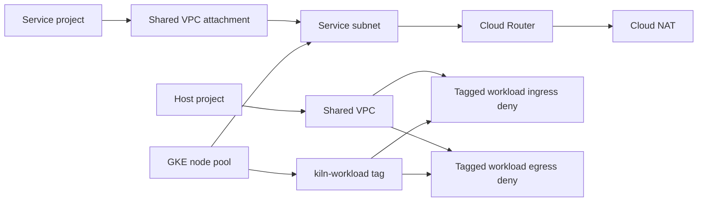

# Network design

These diagrams describe the modules in this repository. They do not represent deployed cloud infrastructure. AWS is applied only to the local emulator. Azure and GCP are validated and tested with mocked providers.

## AWS hub VPC

The security group allows no ingress or egress by default. Callers must provide explicit rules. Public subnet routing uses an internet gateway. Private subnet routing uses the NAT gateway when both subnet types are configured. The security group is not automatically attached to workload interfaces by this module.

## Azure hub and spoke

The module associates an NSG with each workload subnet. Explicit deny rules cover inbound traffic on both NSGs and outbound traffic on both NSGs. Their priority is 4096, which takes precedence over Azure's lower-priority default rules. The module defines no allow exceptions.

## GCP Shared VPC

The ingress and egress deny rules target `kiln-workload` at priority 65534. GKE node pools require this tag, including when a caller overrides the node tags. This leaves higher-priority explicit rules possible while the default is deny.

## Default network rules

| Cloud and module | Source | Destination | Port or protocol | Default action | Reason |
|---|---|---|---|---|---|
| AWS `net` security group ingress | No configured source | VPC workloads using the group | All | Deny by absence of ingress rules | Require callers to declare inbound access |
| AWS `net` security group egress | No configured source | No configured destination | All | Deny by absence of egress rules | Require callers to declare outbound access |
| Azure hub NSG inbound | Any | Hub workload subnet | All | Deny | No inbound exception is defined |
| Azure hub NSG outbound | Any | Any | All | Deny | Overrides platform default outbound allows |
| Azure spoke NSG inbound | Any | Spoke workload subnet | All | Deny | No inbound exception is defined |
| Azure spoke NSG outbound | Any | Any | All | Deny | No outbound exception is defined |
| GCP Shared VPC ingress | `0.0.0.0/0` | Workloads tagged `kiln-workload` | All | Deny | Deny traffic to tagged workloads by default |
| GCP Shared VPC egress | Tagged workloads | `0.0.0.0/0` | All | Deny | Deny traffic from tagged workloads by default |

This table lists rules configured by the modules. It is not a complete account-level firewall inventory. AWS security groups are allow-only; omitted rules deny traffic. GCP deny rules only affect instances with the target network tag. Provider defaults and rules created outside these modules are not audited by this table.
