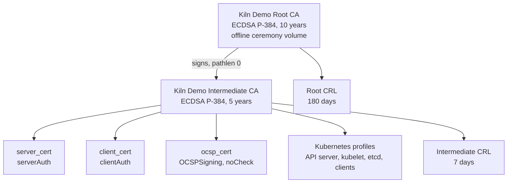

# PKI

A two-tier certificate authority built with OpenSSL 3.5 scripts in `pki/`. Key material lives in Docker volumes or temporary directories and never in the repository. `pki/scripts/lib.sh` refuses to create keys under the repository path.

## Hierarchy

## X.509 profile

| Profile | Key | Validity | Key usage | Extended key usage | SAN | CRL DP | AIA |
|---------|-----|----------|-----------|--------------------|-----|--------|-----|
| Root CA | P-384 | 3650 days | keyCertSign, cRLSign | none | none | none | none |
| Intermediate CA | P-384 | 1825 days | keyCertSign, cRLSign | none | none | root.crl | none |
| server_cert | P-256 | 90 days | digitalSignature | serverAuth | required | intermediate.crl | OCSP and caIssuers |
| client_cert | P-256 | 90 days | digitalSignature | clientAuth | required | intermediate.crl | OCSP and caIssuers |
| ocsp_cert | P-256 | 90 days | digitalSignature | OCSPSigning (critical) | none | none | none |
| kube_apiserver | P-256 | 365 days | digitalSignature, keyEncipherment | serverAuth | service IP and cluster names | intermediate.crl | none |
| kube_client | P-256 | 365 days | digitalSignature, keyEncipherment | clientAuth | none | intermediate.crl | none |
| kubelet_serving | P-256 | 365 days | digitalSignature, keyEncipherment | serverAuth, clientAuth | node name and IP | none | none |
| etcd_peer | P-256 | 365 days | digitalSignature, keyEncipherment | serverAuth, clientAuth | member name and IP | none | none |
| etcd_client | P-256 | 365 days | digitalSignature, keyEncipherment | clientAuth | none | none | none |

Every leaf carries a Subject Key Identifier and an Authority Key Identifier. The intermediate has `basicConstraints = critical, CA:true, pathlen:0`, so it cannot sign another CA. The algorithm choice is recorded in [ADR 0006](adr/0006-pki-algorithms.md).

## Ceremony

The root key exists only in the `pki-root` volume. That volume is mounted for the ceremony and never for daily work.

1. Two people are present: an operator and an approver. The approver checks that the host has no network share or sync client mapped to the volume.
2. Run `docker compose run --rm -v kiln-pki-root:/pki/root -v kiln-pki-intermediate:/pki/intermediate -v kiln-pki-public:/pki/public toolbox pki/scripts/ceremony.sh`.
3. The script prints six numbered steps and the root SHA-256 fingerprint. The approver records the date, the fingerprint and both names in the ceremony log.
4. Unmount the root volume. Export it with `docker run --rm -v kiln-pki-root:/v -v <offline-media>:/o alpine tar czf /o/root.tgz -C /v .` to offline media and store the media in a locked place.
5. Daily operations mount only `kiln-pki-intermediate` and `kiln-pki-public`.

This is an offline-style ceremony on a developer workstation. It shows the steps. It does not provide the isolation of an air-gapped host or an HSM.

## Issue, revoke and publish

| Task | Command |
|------|---------|
| Create a key and CSR | `pki/scripts/csr.sh web web.kiln.test DNS:web.kiln.test` |
| Issue | `pki/scripts/issue.sh web server_cert` |
| Verify the chain | `pki/scripts/verify.sh /pki/issued/web/cert.pem` |
| Revoke | `pki/scripts/revoke.sh web keyCompromise` |
| Publish the CRL | `pki/scripts/gen-crl.sh` |
| Verify with CRLs | `pki/scripts/verify.sh /pki/issued/web/cert.pem --crl` |
| Kubernetes set | `pki/scripts/k8s-certs.sh node-0 10.240.0.20` |

## CRL and OCSP

`gen-crl.sh` signs a new intermediate CRL with a 7 day `nextUpdate` and writes `crls.pem` with both CRLs for full-chain checks. Run it after every revocation and at least weekly.

`ocsp-responder.sh foreground` runs `openssl ocsp` against the intermediate `index.txt`. It signs responses with the delegated `ocsp_cert`, which carries `noCheck` so clients do not need a revocation check for the responder itself. The `ocsp` Compose service runs it on port 2560. `ocsp-check.sh <cert>` prints `good`, `revoked` or `unknown`.

The OpenSSL responder handles one request at a time. It is suitable for a demonstration. It is not a production OCSP service.

## Rotation

`rotate.sh <name>` moves the current key and certificate to `previous/`, creates a new key and CSR and issues a new certificate with the same profile and SAN. Both certificates stay valid during the overlap, so clients that still hold the old chain keep working. `rotate.sh <name> --deploy` then runs `ansible/pki-deploy.yml`. That playbook copies the new full chain and key to the nginx target and reloads nginx with `nginx -s reload`, which keeps open connections.

Revoke the previous certificate with reason `superseded` once every client uses the new one.

`expiry-monitor.sh 30` lists certificates inside a 30 day window and exits 1 when any are found, so a scheduler can alert on it.

## Compromise response

| Event | Action |
|-------|--------|
| Leaf key compromise | Revoke with `keyCompromise`, run `gen-crl.sh`, rotate the leaf, confirm `ocsp-check.sh` reports revoked. |
| Intermediate key compromise | Mount the root volume. Revoke the intermediate with the root CA. Publish a new root CRL. Create a new intermediate, then reissue every leaf. The [CA compromise procedure](procedures/respond-to-ca-compromise.md) lists each command. |
| Root key compromise | Treat every certificate as untrusted. Remove the root from every trust store, run a new ceremony and reissue everything. |

## Evidence

| Check | Command | Result |
|-------|---------|--------|
| PKI behaviour | `./scripts/tb.ps1 bats tests/test_pki.bats` | 11 of 11 passed on 2026-11-15. Log `artifacts/logs/test-pki.log`. |
| Kubernetes certificates | `./scripts/tb.ps1 bats tests/test_pki_k8s.bats` | 7 of 7 passed on 2026-11-15. Log `artifacts/logs/test-pki-k8s.log`. |
| Rotation deploy to nginx | `docker compose run --rm --no-deps toolbox bash scripts/test-pki-deploy.sh` | 5 of 5 passed on 2026-11-15. New serial served, nginx master PID unchanged. Log `artifacts/logs/test-pki-deploy.log`. |
