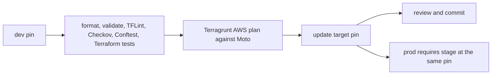

# Environment promotion

Each environment pins the shared module version in `live/<environment>/env.hcl`. `scripts/promote.ps1` runs the gates before changing the target pin. It does not create a commit.



Run a promotion from dev to stage with:

```powershell
.\scripts\promote.ps1 -From dev -To stage
```

Promotion to prod is blocked unless stage already uses the source version. The script updates only the target `module_version` after each gate succeeds. Azure and GCP units are validated but are not planned against a real cloud.

Rollback by reverting the commit that changed the target pin:

```powershell
git revert <promotion-commit>
```

Promotion unit tests replace Docker with a fake executable. They verify gate ordering, failure handling, the prod pin check and that no gate runs in a login shell.

A real run on 2026-11-18 (`.\scripts\promote.ps1 -From dev -To stage`, log `artifacts/logs/promotion-dev-stage.log`) ran all seven gates against the toolbox and the emulator and updated the stage pin in 39 minutes. The first real run found that `bash -lc` hid the toolbox venv from the Checkov gate, fixed in `scripts/promote.ps1`.
