# Screenshots

Each image is rendered by `scripts/terminal_shot.py` from the real output and exit code of the command shown at its top. Text is not edited except redaction of emails, tokens, account IDs and URLs. The footer states how many values were redacted. "Recorded run" images show lines from a log in `artifacts/logs` written by the named run. `scripts/capture-all.ps1` renders them all again.

The public GitHub pages at the end are captured unedited by `scripts/capture_github.py` (Playwright, signed out, 1440 by 900). The architecture explainer video is Not verified.

## tb-versions

Pinned tool versions in the toolbox (live)

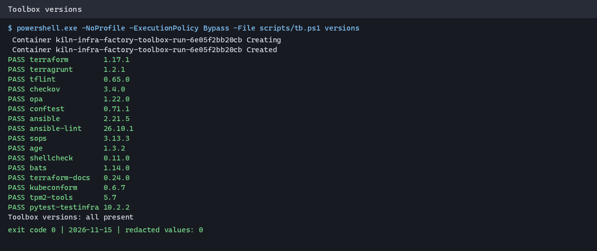

## tf-validate-all

fmt, validate and examples for 17 modules (recorded run)

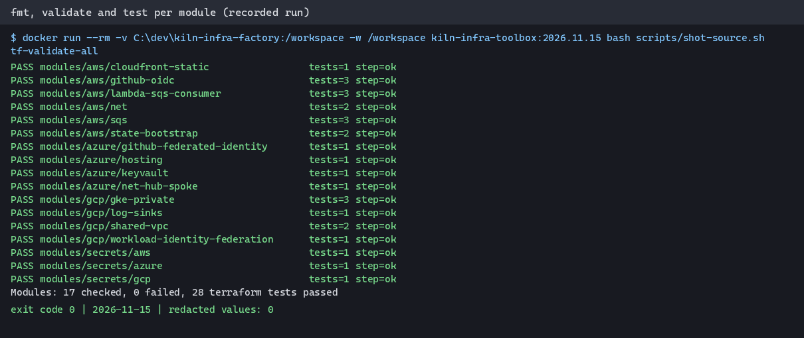

## terraform-test

terraform test per module (recorded run)

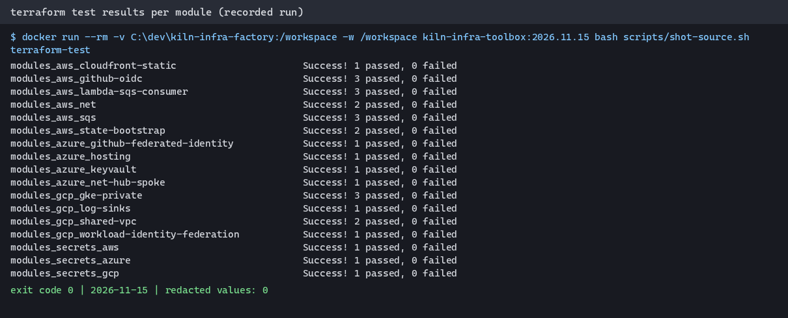

## checkov-summary

Checkov: 687 passed, 0 failed, 34 accepted skips (recorded run)

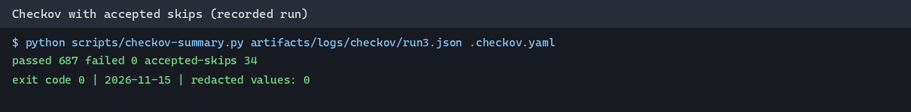

## conftest-pass

Conftest on modules and live (live)

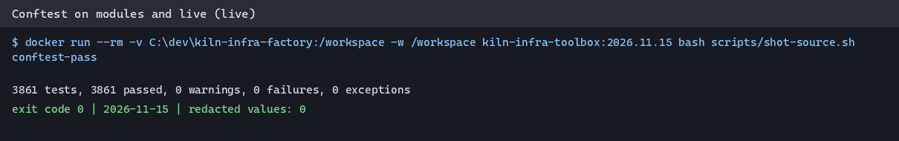

## conftest-deny

Conftest denies the bad HCL fixtures (live)

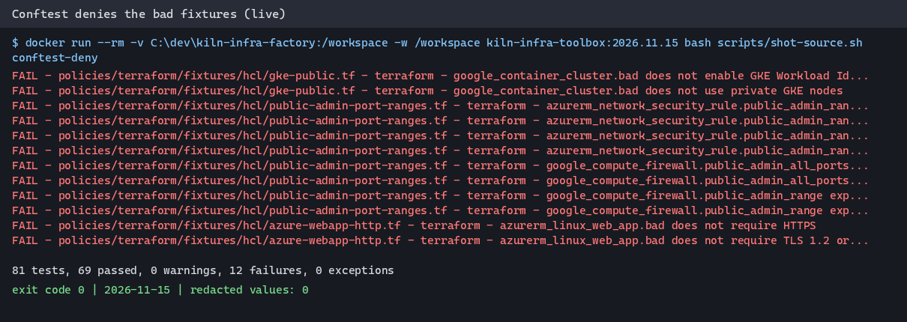

## terragrunt-plan

Terragrunt validate for all three environments, then plan, apply and destroy of the dev AWS units (recorded run). stage and prod apply are Not verified

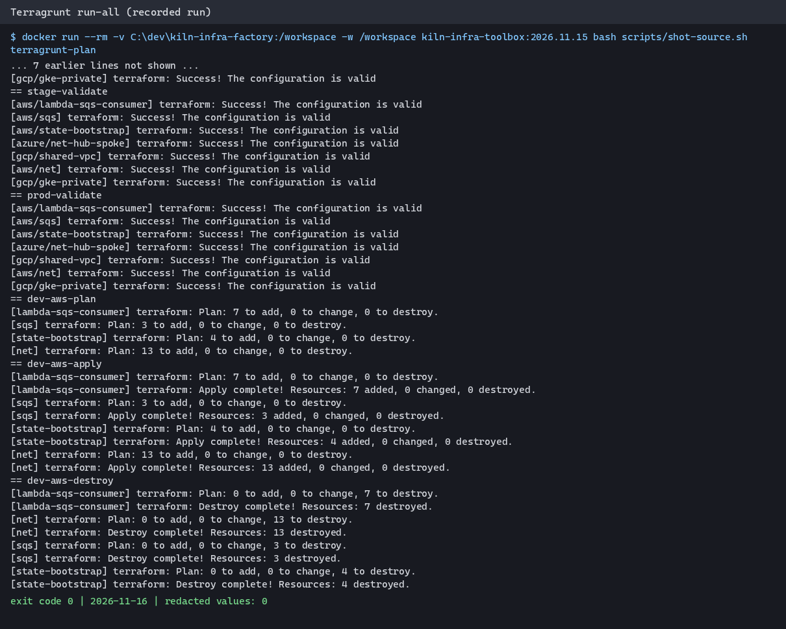

## remote-state

State migration and lock refusal on the emulator (recorded run)

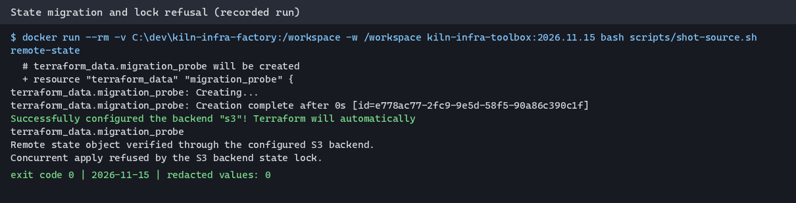

## drift-detected

Drift demo with exit code 2 and the classified final plan (recorded run)

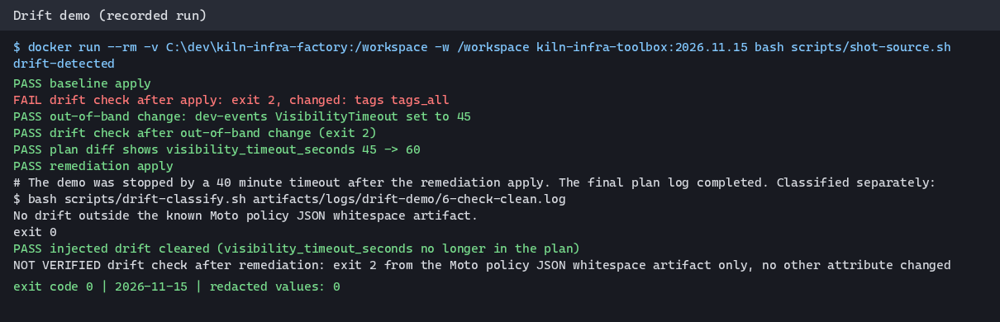

## promotion-gates

Promotion gate tests with stubbed gate commands (live)

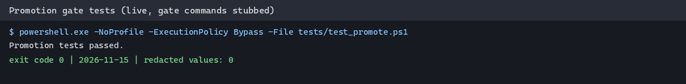

## ansible-recap

Ansible recap, lint and testinfra (recorded run)

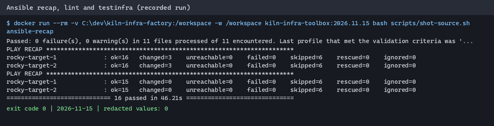

## pki-chain-verify

PKI tests (live)

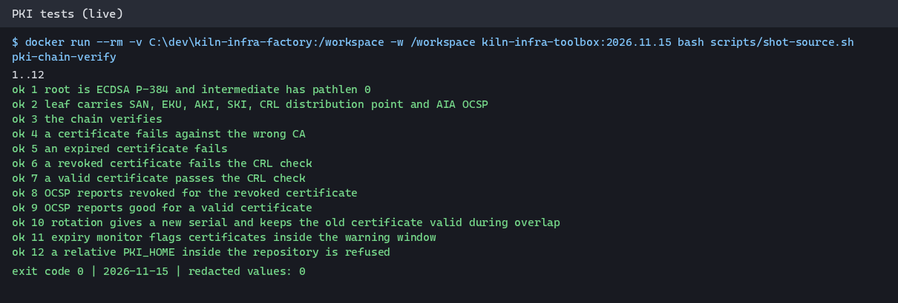

## pki-revoked-crl

Revoked certificate fails the CRL check (live)

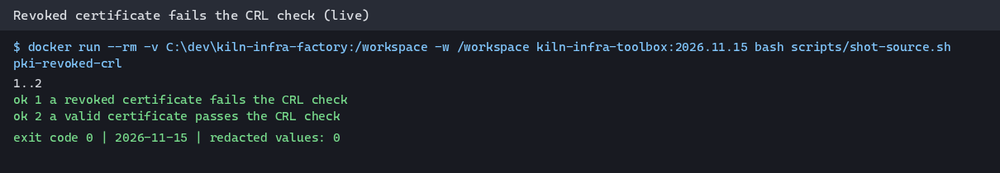

## ocsp-revoked

OCSP reports revoked and good (live)

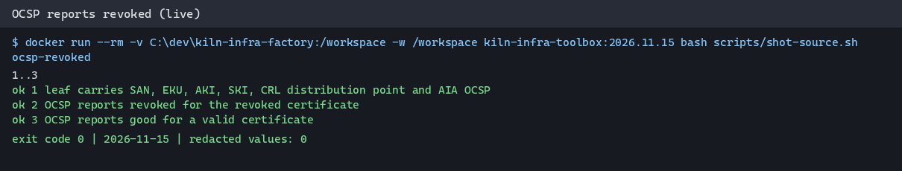

## cert-rotation

Rotation deployed to nginx with a graceful reload (recorded run)

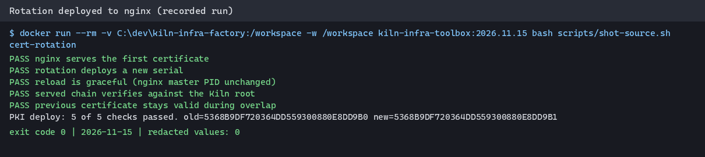

## tpm-unseal-ok

TPM tests on swtpm (recorded run)

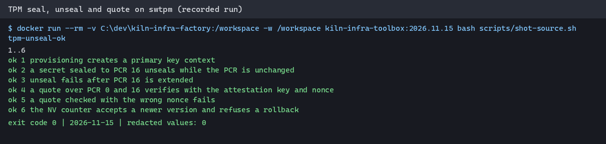

## tpm-unseal-fail

Unseal fails after a PCR extend (recorded run)

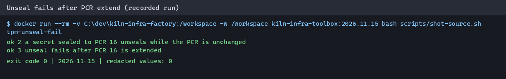

## sops-encrypted

Committed SOPS file is encrypted (live)

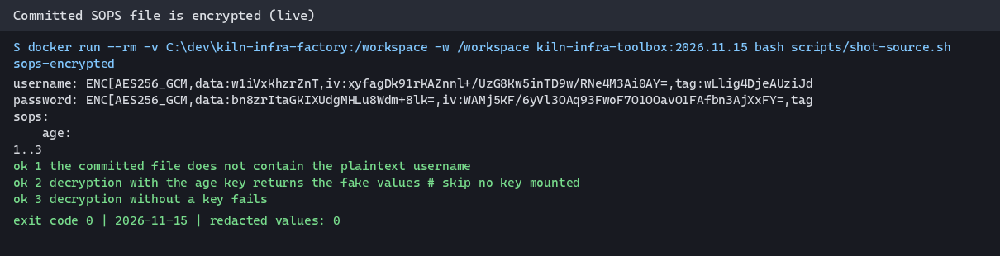

## kind-apply

kind apply and pod checks (recorded run)

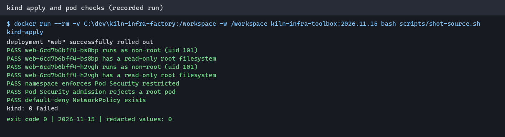

## k8s-certs-verify

Kubernetes component certificates (live)

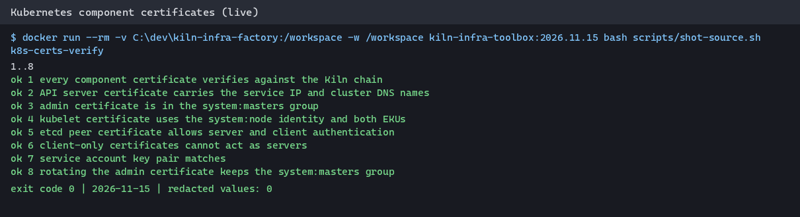

## tests-green

Summary line of each test suite (recorded runs)

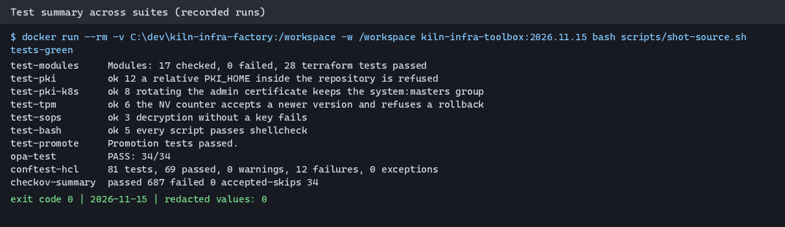

## secret-scan

gitleaks on history and tree (live)

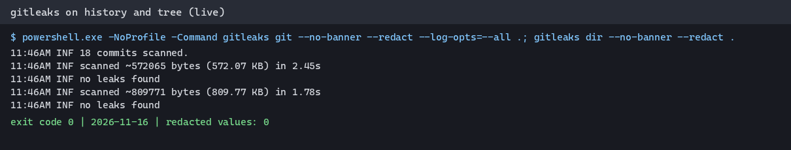

## skills-report

Skills gate (live)

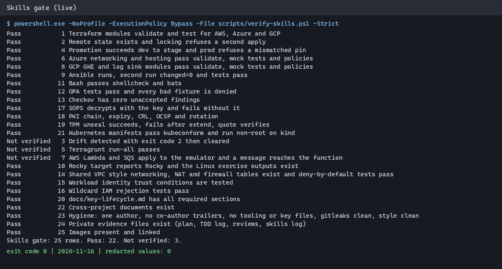

## GitHub pages

Captured on 2026-11-18 with `python scripts/capture_github.py`, signed out.

### github-ci-green

CI runs on main

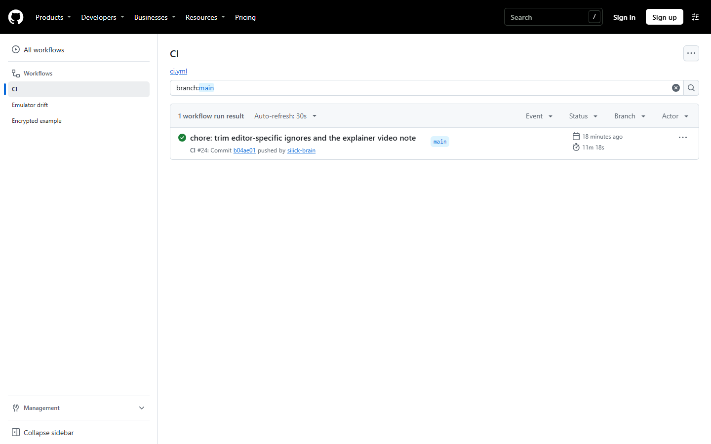

### github-drift-workflow

Emulator drift workflow on main

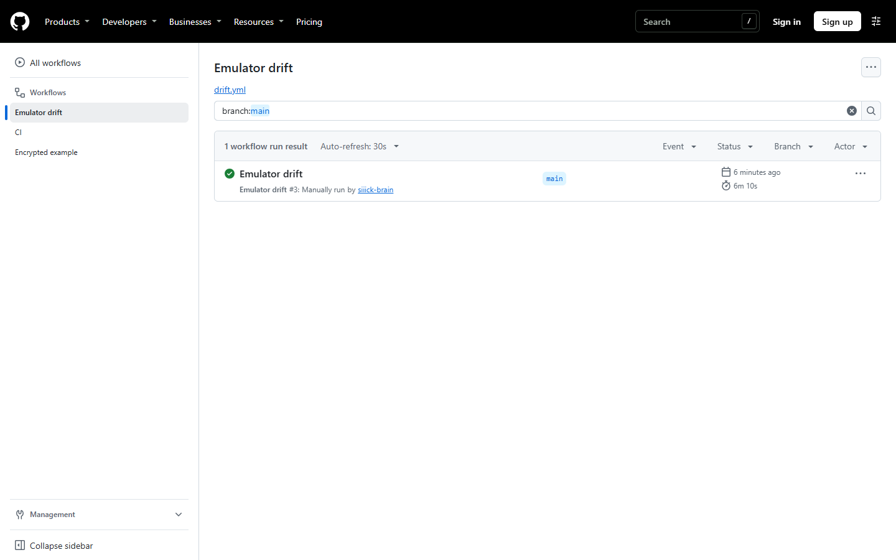

### github-readme-top

Repository page with description and topics

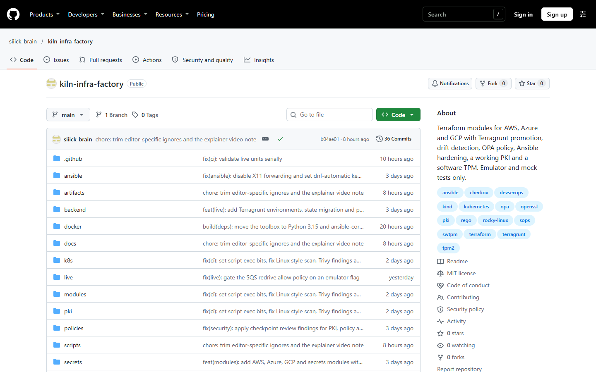

### github-readme-architecture

Architecture diagram as GitHub renders the README

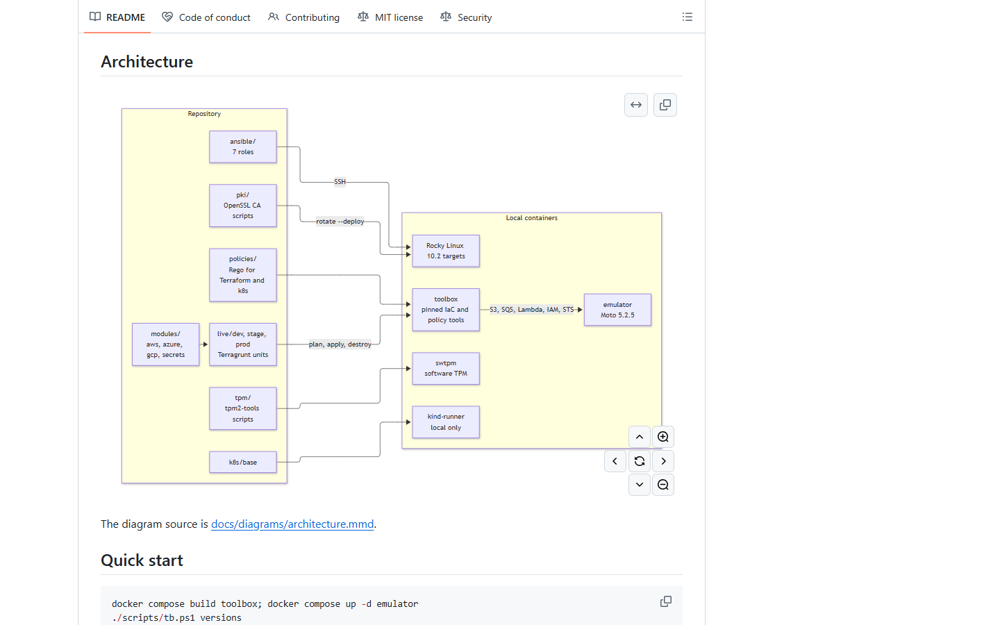

### github-contributors

Contributors graph: one author

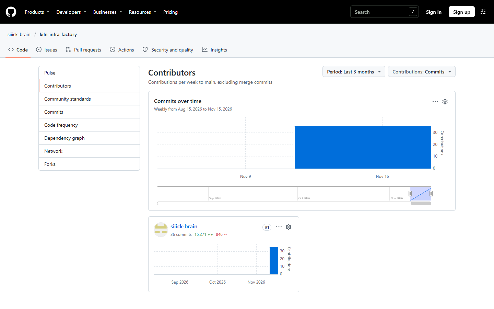
