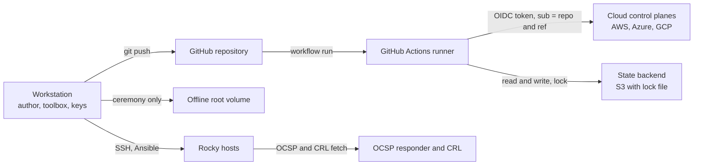
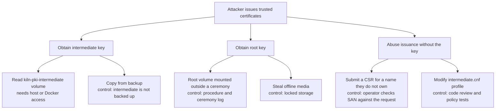
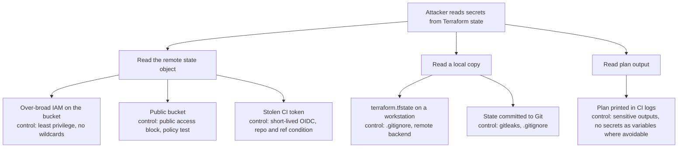

# Threat model

Scope: the infrastructure factory as it would run for a real team. That means the repository, the CI workflows, the Terraform state backend, the PKI, the secrets workflow and the hosts configured by Ansible. The local demonstration uses an emulator and fake keys. The model describes the design, not a deployed system.

Method: STRIDE per trust boundary, two attack trees and practice notes in the style of OWASP SAMM. No maturity level is claimed.

## Assets

| Asset | Why it matters |
|-------|----------------|
| Root CA private key | Signs the intermediate. Compromise breaks every certificate. |
| Intermediate CA private key | Issues every leaf certificate. |
| Terraform state | Holds resource IDs and can hold secret values in plain text. |
| age private key | Decrypts committed SOPS files. |
| CI identity (OIDC federation) | Can plan and apply in each cloud within its role. |
| Module source and version pins | Define what reaches each environment. |
| Ansible SSH key | Root-equivalent access to managed hosts through sudo. |
| Policy code | Decides what is allowed to merge. |

## Trust boundaries

| ID | Boundary |
|----|----------|
| TB1 | Workstation to GitHub |
| TB2 | GitHub to the CI runner |
| TB3 | CI runner to the cloud control plane |
| TB4 | CI runner and workstation to the state backend |
| TB5 | Workstation to the offline root volume |
| TB6 | Workstation to managed hosts |

## STRIDE

| Boundary | Threat | Example | Control in this repository | Status |
|----------|--------|---------|----------------------------|--------|
| TB1 | Spoofing | A commit under someone else's identity | `commit-msg` hook checks the author email against `.github/allowed-author`. CI repeats the check | Verified locally, CI Planned |
| TB1 | Tampering | A dependency or action changed upstream | Actions pinned by full SHA, images by digest, tool downloads checked by SHA-256 | Verified in Dockerfiles |
| TB1 | Information disclosure | A secret committed by mistake | gitleaks on tree and history, SOPS for secrets, `.gitignore` for key files | Verified |
| TB2 | Elevation of privilege | A pull request from a fork runs with secrets | No `pull_request_target`, `permissions` set per job, `persist-credentials: false` | Planned in item 21 |
| TB3 | Spoofing | Another repository or branch obtains the CI cloud role | OIDC trust requires the exact repository and ref in `sub` (AWS), the subject (Azure) and an attribute condition (GCP) | Verified by mock tests |
| TB3 | Elevation of privilege | The CI role can do more than needed | No wildcard actions or resources, enforced by OPA and module tests | Verified by tests |
| TB4 | Information disclosure | State read by an unauthorised principal | Encrypted bucket, public access block, state access limited to the CI role | Emulator only |
| TB4 | Tampering | Two applies corrupt state | S3 native lock file. A second apply is refused | Verified on the emulator |
| TB4 | Repudiation | No record of who changed state | Bucket versioning keeps prior state. Cloud audit logs Planned | Partial |
| TB5 | Information disclosure | Root key copied during routine work | Root volume mounted only in the ceremony. Two-person ceremony log | Procedure only |
| TB6 | Spoofing | A host impersonates a target | SSH host keys pinned in a known-hosts file per run | Verified in the Ansible test |
| TB6 | Elevation of privilege | Password or root SSH login | `ssh_hardening` disables both. testinfra checks `sshd -T` | Verified |
| PKI | Spoofing | A certificate used after compromise | CRL and OCSP. The revoked test certificate fails both | Verified |
| PKI | Denial of service | OCSP responder unavailable | CRL remains as a fallback. The OpenSSL responder is single-threaded | Accepted for the demonstration |

## Attack tree: CA key compromise

Response: [respond to CA compromise](procedures/respond-to-ca-compromise.md).

## Attack tree: state file exposure

Response: [recover state](procedures/recover-state.md) and [secrets in state](state.md).

## Practice notes (SAMM style)

| Business function | Practice | What exists here | Gap |
|-------------------|----------|------------------|-----|
| Governance | Policy and compliance | Policy as code with a catalog that maps rules to controls | No formal policy approval process |
| Design | Threat assessment | This document | Not reviewed by a second person |
| Design | Security requirements | Module variables validate inputs. Policies encode requirements | Requirements are not traced to tickets |
| Implementation | Secure build | Pinned tools, SHA-256 checks for tool downloads, pinned actions | No SBOM or provenance attestation |
| Implementation | Defect management | Findings recorded with counts. Accepted Checkov skips carry a justification | No tracker |
| Verification | Security testing | Policy tests with failing fixtures, PKI and TPM tests, Checkov, Trivy, gitleaks | No dynamic testing |
| Operations | Incident management | Procedures for CA compromise, state recovery and key rotation | Never exercised as a drill |

These notes describe activity. They do not assign a SAMM maturity level.
